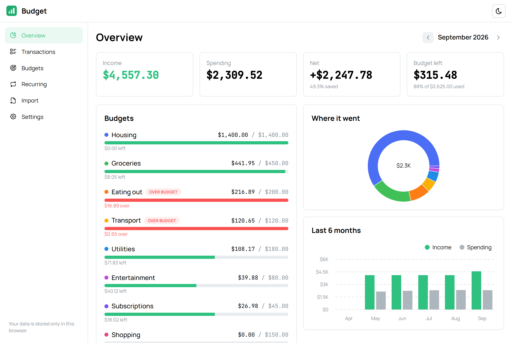
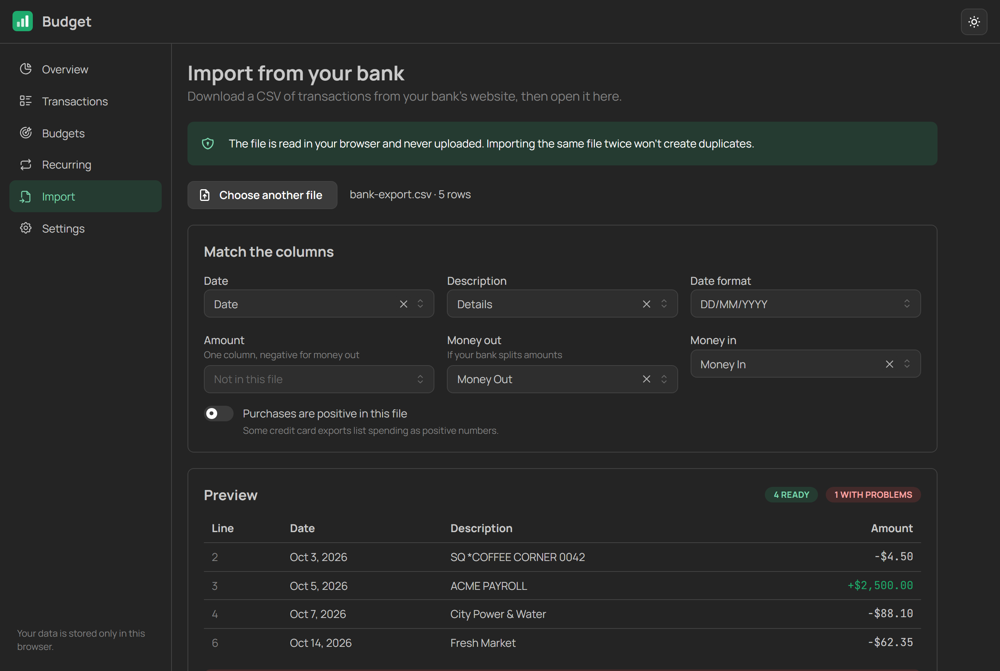
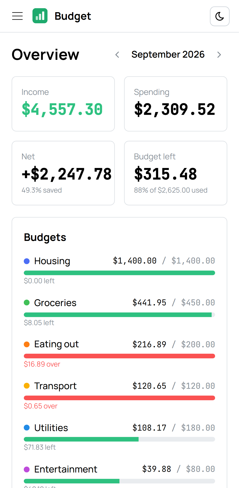

# Budget

A budget tracker that keeps your finances on your own device. There's no account and no server. It installs like an app and works offline.

**Try it:** https://budget-tracker-two-kohl.vercel.app. Choose **Explore with sample data** to see six months of example spending.



## What it does

- **See the month at a glance:** income, spending, what you saved, and how much budget is left.
- **Budget by category:** each category gets a progress bar. It turns yellow when you're spending faster than the month is passing, and red when you're over.
- **Import from your bank:** open the CSV your bank exports. The app works out which column is which and which date format the bank uses, shows a preview, and skips anything already imported.
- **Recurring transactions:** rent, salary and subscriptions are added automatically each month, including months you didn't open the app.
- **Your data, your copy:** download a backup to move to another browser, or export a CSV for a spreadsheet.

<p>
  
  
</p>

## Why it works this way

**Why no server?** Bank transactions are some of the most personal data there is. Here everything is stored in the browser's IndexedDB. Import files are read in the browser and never uploaded, and the app makes no API calls. The trade-off is that your data lives in one browser, which is why backup and restore are on the Settings page.

**Why are amounts stored as whole cents?** `0.1 + 0.2` isn't `0.3` in floating point. Every amount is an integer number of cents from the moment it's parsed, so totals can't drift. The parser also handles what real bank exports contain: `1,234.56`, `(12.00)` for a negative, `12.00-`, non-breaking spaces as thousands separators, and currency symbols. It rejects anything ambiguous, such as `--5`.

**How does re-importing the same file avoid duplicates?** Each imported row gets a key built from its date, amount and description, plus a counter. The counter means two identical coffees on the same day are both kept, but importing the same file a second time adds nothing. Imports run inside a single IndexedDB transaction, so a failure never leaves half a file behind.

**Why does rent never trigger the "spending fast" warning?** The warning compares how much of a budget is used with how far through the month it is: 60% spent on the 10th is a warning, 60% on the 25th is not. That makes sense for groceries but not for rent, which is paid in one go on the 1st. Categories can be marked as **fixed bills**, and those only warn when they actually go over.

**What if two tabs are open when rent is due?** Recurring transactions are created inside a database transaction that re-reads the rule first, so only one tab creates this month's rent. A test runs two catch-ups at the same moment to check this.

**How does it guess the date format?** `03/04/2026` could be March or April. The app tries each format on the file's dates and picks the one that reads the most of them, so a later `13/04/2026` settles it. Picking the best fit rather than demanding a perfect one means a single impossible date (one test file contains "31/09") doesn't throw everything off. That row is reported by its line number instead.

## Built with

- **App:** React 19, TypeScript and Vite
- **UI:** Mantine (components, forms, dates, charts, notifications)
- **Storage:** Dexie, with live queries that update every open tab
- **Offline and install:** vite-plugin-pwa (Workbox)
- **Import:** Papa Parse for CSV, Zod to validate backup files
- **Tests:** Vitest with fake-indexeddb, and Playwright

## Tests

```bash
npm install
npm test            # 65 unit and database tests
npm run test:e2e    # 14 browser tests: 7 scenarios on desktop and mobile
BASE_URL=https://budget-tracker-two-kohl.vercel.app npm run test:e2e   # the same suite against the live site
```

- **Unit tests** cover money parsing, date maths (including leap years and the 31st in short months), budget status, recurring catch-up, CSV parsing and duplicate keys, category suggestions, and spreadsheet-safe exports (cells starting with `=` can't run as formulas).
- **Database tests** use a fake IndexedDB to check imports, recurring transactions, deleting categories, and backups. A damaged backup file is rejected without touching existing data.
- **Browser tests** run against the production build: sample data, adding a transaction, importing the same CSV twice, setting a budget, undoing a delete, a backup round trip, and going offline then reloading.

CI runs all of it on every push, along with `npm audit`.

## Run locally

```bash
npm install
npm run dev
```

## Project layout

```
src/lib/     Pure logic: money, dates, budgets, CSV, recurring, categories (no React)
src/data/    Dexie database, repository functions, live hooks, sample data
src/pages/   Overview, transactions, budgets, recurring, import, settings
e2e/         Playwright tests and a sample bank export
```

## License

[MIT](LICENSE)
